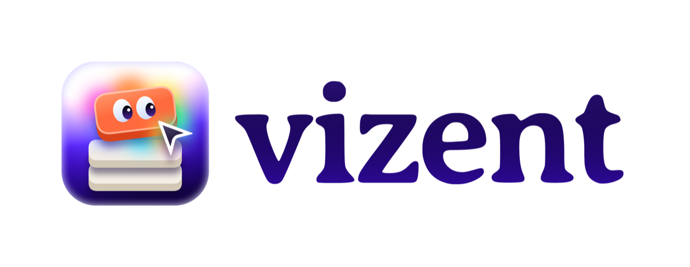

<p align="center">
  <picture>
    <source media="(prefers-color-scheme: dark)" srcset="assets/vizent-logo-dark.png">
    
  </picture>
</p>

<p align="center">
  <strong>Click any element in your running app. Describe the change. Your coding agent edits the real source.</strong>
</p>

<p align="center">
  
  
</p>

---

> [!NOTE]
> 🚧 **Pre-release.** vizent is in active development and not ready to install yet.
> Star or watch this repo to hear when the first version ships.

## Why

Changing UI today means bouncing between the browser, devtools, and your editor —
finding the right component, the right file, the right token. vizent closes that loop:
you point at what you see, and the change lands in your code.

## What it will do

- **Select in the browser.** Click any element in your app running on localhost.
- **Edit like a design tool.** A panel as simple as Figma's design panel. Changes preview live.
- **Review every change.** Edits queue as suggestions you accept or reject, one by one.
- **Choose the scope.** Apply a change to this instance, this variant, or the whole component.
- **Tokens first.** Edits use your design tokens, falling back to raw values only when needed.
- **Any framework, any agent.** Framework-agnostic, and works with any coding agent via MCP.
- **Design-system extraction.** See your app's design system on a live dev route.

<!-- Add a concept image or prototype GIF here once you have one, labelled "Concept":
 -->

## Who it's for

Design engineers, and designers who write frontend code.

## Getting started

Not available yet. vizent will ship as an npm package with a CLI. The planned flow:

```bash
# planned — not published yet
npx vizent
```

## Roadmap

- [x] Product spec
- [x] Name and brand
- [ ] Element selection on localhost
- [ ] Selected-element edit panel with live preview
- [ ] Accept / reject suggestion queue
- [ ] Edit scope: instance / variant / whole component
- [ ] Tokens-first editing with raw-value fallback
- [ ] MCP integration for coding agents
- [ ] Design-system extraction (live dev route)
- [ ] First public release on npm

## Under the hood

The spike in this repo proves the hardest part: a clicked element maps back to the
exact source file and line, and a coding agent can read that selection over MCP.

- [`docs/SPIKE-README.md`](docs/SPIKE-README.md) — what runs today, and how to try it
- [`docs/SPIKE-REPORT.md`](docs/SPIKE-REPORT.md) — what the spike measured
- [`docs/PRD.md`](docs/PRD.md) — where this is going

## Follow along

- ⭐ **Star** or 👀 **watch** this repo for release updates
- 🌐 [sayerhs.com](https://sayerhs.com)
- 𝕏 [@saayerhs](https://x.com/saayerhs)
- 💼 [LinkedIn](https://www.linkedin.com/in/shreyasbhosale/)

## Contributing

It's early, and feedback is the most useful contribution right now.
If the idea resonates — or something about it doesn't — please
[open an issue](../../issues) and share how you'd use it.

## License

[MIT](LICENSE)
